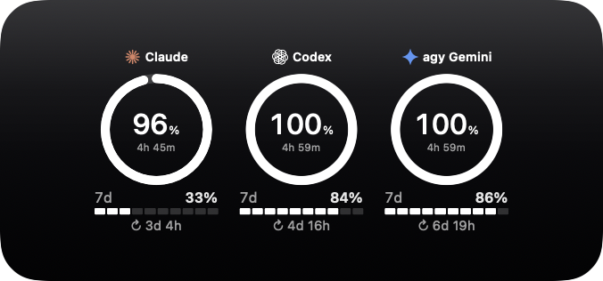
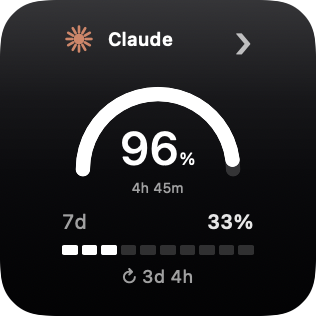
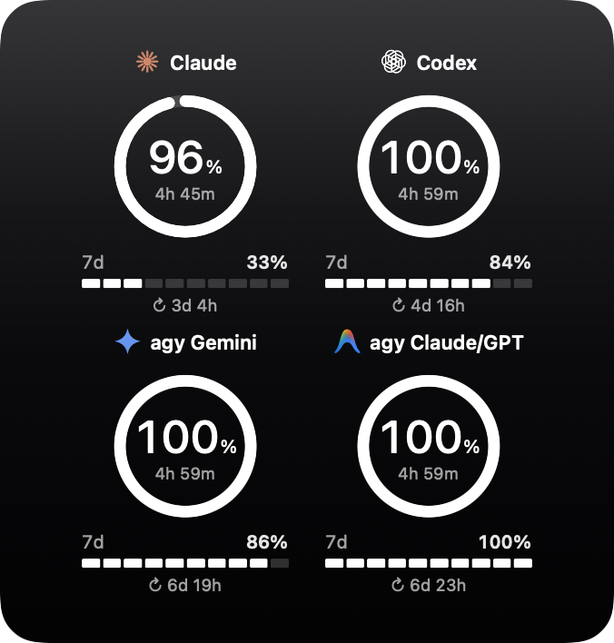
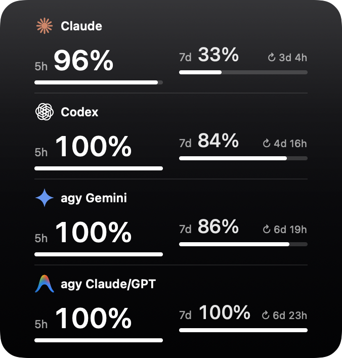
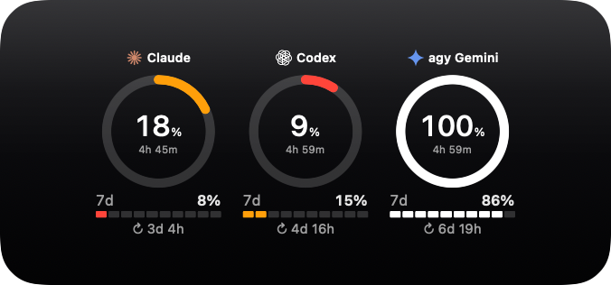

# Arcmeter

Arcmeter is a macOS desktop widget that shows how much of your AI usage quota you have left for Claude, Codex, and Antigravity, so you can check it at a glance instead of opening each app.

For each provider, it shows two windows:

- **The 5-hour window** as a ring (a half-circle on the small widget), with the quota left and a live countdown to the reset.
- **The weekly window** as a segmented bar, with its reset time.

Both turn orange when quota runs low and red when it is almost gone. Arcmeter comes in small, medium, and large sizes, plus a Ledger layout with one row per provider and both bars side by side.

| Small: one provider | Large: all four | Ledger: bars side by side | Low quota: warnings |
| :---: | :---: | :---: | :---: |
|  |  |  |  |

It is for anyone who uses Claude, Codex, or Antigravity regularly and wants to know how much room is left without digging through settings. It has no server or telemetry of its own.

## Requirements

macOS 15 or later, and the `quota-axi` command-line tool installed.

## Getting started

1. Open `AIQuotaWidget.xcodeproj` in Xcode and run the app.
2. Control-click the desktop, choose **Edit Widgets**, and search for **Arcmeter**.
3. Drag the widget onto the desktop. Keep the app running so the numbers stay fresh.

Build, test, and implementation details are in [docs/DEVELOPMENT.md](docs/DEVELOPMENT.md).

## License

MIT - see [LICENSE](LICENSE).
